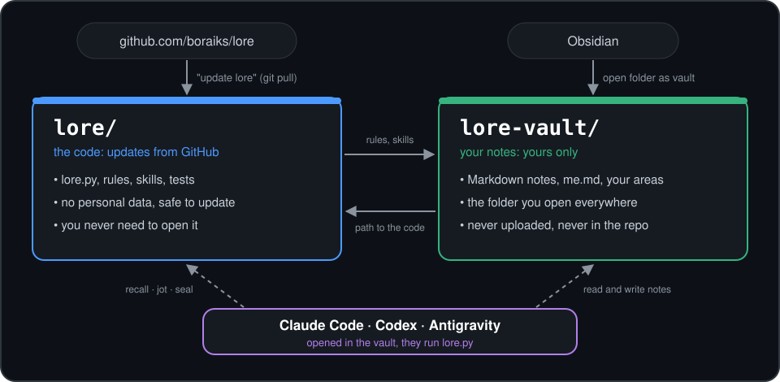

<div align="center">

# lore

### A second brain your AI agents share.

**Plain Markdown, opened in Obsidian, kept by Claude Code, Codex and Antigravity. Nothing leaves your computer.**

[](LICENSE)


[Quick start](#quick-start) · [Two folders](#two-folders) · [Day to day](#day-to-day) · [Updating](#updating) · [Commands](#commands) · [FAQ](#faq)



</div>

> [!IMPORTANT]
> lore is **two folders**. `lore` is the code from this repository: it takes every update and holds nothing of yours. `lore-vault` is your notes: it never enters this repository, and no update rewrites it.

You switch between AI clients; your memory should not care. lore keeps one vault of Markdown notes that every client reads and writes the same way. Agents search it instead of loading it whole, and at the end of real work they leave a short, linked record of what happened.

- **Plain files, nothing else.** Python standard library only. No database, embeddings, server, network or model calls. Your notes are Markdown you can open, grep and back up.
- **The agent writes the outcome.** When meaningful work is done, the agent that knows the conversation records 3-8 linked lines: what was done, what was decided and why, what is open, what comes next. Hooks never write notes; they remind once.
- **Private by design.** Every write passes a secret filter. Hooks act only inside folders you allow, private folders and sessions are skipped, and a test fails if machine details ever leak into this repository.
- **Turkish-aware.** Search tolerates Turkish suffixes (`mülakatlar` finds a note saying `Mülakatı`), and the secret filter knows Turkish ID and phone numbers. Every other language works with plain matching.

## Quick start

1. In Obsidian, create a new vault (or pick an existing one). This folder becomes your `lore-vault`; it can live anywhere.
2. Open that same folder in your AI client (Claude Code, Codex or Antigravity).
3. Paste this message, in any language you like:

```text
Read https://github.com/boraiks/lore/blob/main/INSTALL.md and set up lore with this folder as my vault.
Keep every note that is already here. Show me each hook change before applying it.
At the end, save a test note and read it back so we can check it together.
```

The agent does the rest:

| Step | What happens |
|---|---|
| Check | Python and git are there. |
| Code | lore is cloned into its own folder in your home folder (`~/lore`), apart from your notes. |
| Vault | Your folder gets lore's rules, skills and Obsidian starter settings. Nothing already there is touched. |
| Intro | A few short questions (you can skip any): what you use the memory for, what you work on, how you like answers. Only the areas you choose are created; your answers go to `me.md`. If setup misses it, the next session asks. |
| Hooks | You see every change to your clients' settings first; nothing is applied without your yes. If your client's safety check blocks the command (Claude Code may, even for the dry run), the agent gives you the one command to run yourself. In Codex, approve the hooks with `/hooks`. |
| Test | The tests run, and a test note is saved and read back. |

Prefer to do it by hand? See [Manual setup](#manual-setup).

## Two folders

|   | `lore` | `lore-vault` |
|---|---|---|
| **What it is** | the code: `lore.py`, rules, skills, tests | your notes: Markdown, `me.md`, your areas |
| **Where it comes from** | cloned from this repository | the folder you chose at setup |
| **What changes it** | updates (`git pull`) | you and your agents |
| **Personal data** | never | yes, and only here |
| **You open it in** | nothing; you never need to | Obsidian and your AI client |
| **Default place** | `~/lore` (Windows: `%USERPROFILE%\lore`) | anywhere you like |

**How do they find each other?** Setup writes down each folder's full path, so nothing is hard-coded and no drive letter is assumed:
- The vault's `AGENTS.md` and skills hold the path to the code, so an agent working in the vault knows which `lore.py` to run.
- `~/.lore.json` holds the path to the vault (written by `lore.py home`; the `LORE_HOME` environment variable overrides it), so the code knows where your notes are.
- The hooks in your clients' settings call the code's `lore.py`.

There is no server, no sync and nothing running in the background. Moved a folder? For the vault, run `python <lore>/lore.py home <new path>`. For the code, run `python <new path>/lore.py update --no-pull` to rewrite the path in the vault, then `lore.py wire` to see the hook change.

<details>
<summary><b>What is inside the vault</b></summary>

```
lore-vault/
├── home.md            home page
├── me.md              about you: what agents should know first (read at every session start)
├── inbox/             notes without an area yet (always there)
├── sessions/          session outcomes, written by seal (always there)
├── career/            an area you chose: a folder with a note of its own name (career/career.md)
├── ...                any other areas you chose: courses, ideas, research, personal, work, fitness, ...
├── _templates/        Obsidian template with lore's note header
├── AGENTS.md          lore's rules for agents, with the path to the code filled in
├── CLAUDE.md, GEMINI.md  point Claude Code and Gemini clients to AGENTS.md
├── .claude/skills/    skills for Claude Code
├── .agents/skills/    skills for Antigravity and Codex
└── .lore/             logs, session log, settings, list of installed files (hidden)
```

</details>

## Day to day

After setup there is nothing to run. Keep the vault open in Obsidian, open the same folder in your AI client, and talk:

| You say (in any language) | The agent |
|---|---|
| "Do you remember the Acme interview?" | searches with `recall` (the topic plus close words, since search matches words, not meaning) and opens only the matching notes |
| "Note this: ..." | writes a note with `jot`, linked to a related one |
| "Save" / "Wrap up" | records the session outcome with `seal` |
| "Check the memory" | runs `mesh` and suggests fixes without touching anything |
| "Organize the memory" | reads a short inventory and tidies up on its own: merges `fitness` into `spor`, adds `spor` to notes tagged `antrenman` and keeps it, opens a `spor` area, moves the inbox notes there; then tells you what it did |
| "Undo that" | reverts the whole tidy-up with `undo` (notes you changed since are left alone) |
| "Don't save this session" | marks it private; nothing is recorded |
| "Remember that I prefer short answers" | updates `me.md`, which every session reads first |
| "Update lore" | pulls the new code and refreshes the vault's rules ([Updating](#updating)) |
| *(three training notes pile up in inbox)* | suggests a `fitness` area in one sentence and creates it only if you agree |

Long session and no outcome yet? The hook reminds the agent once, right before it stops. Notes the agent writes show up in Obsidian at once.

### Areas are yours

Not everyone studies or hunts for jobs, so lore forces no topics on you. It creates only `inbox` and `sessions`, the two areas it needs itself. Everything else is your choice:
- During setup the agent asks what you will use the memory for and creates just those areas. `lore.py area list` shows yours and the suggested ones (`career`, `courses`, `ideas`, `research`, `personal`, `work`); `lore.py area add <name> "<what goes there>"` adds any area you like.
- An area is simply a folder holding a note of its own name, so a folder and note you make in Obsidian count too.
- Over time, notes that fit no area land in `inbox`. Once a few have piled up, `jot` shows the agent the inbox's tags (`antrenman 2, spor 1, ...`). lore uses no model, so it does not decide what belongs together; the agent reads the meaning and **suggests** a new area in one sentence. It creates the area only if you agree, and moves existing notes into it only after a separate yes. Say no and that area is never suggested again (`lore.py area decline`).
- "Check the memory" also shows how many notes wait in `inbox`, how old the oldest is, and its tags.

### Obsidian

- Open the vault folder itself with "Open folder as vault": the areas sit at its root, with no extra `notes/` level.
- Hidden folders (`.lore`, `.obsidian`) stay out of sight, and lore ignores `_templates` and the agent files when it searches or checks links.
- To write notes by hand with the same header the agents use, use the **Templates** core plugin (on by default); its folder is already set to `_templates`.
- The graph shows three things at once:
  - **colour = area**: each area folder has its own colour, and its area note (`career/career.md`, ...) is the hub its notes link to;
  - **links = topic**: `[[links]]` connect notes about the same thing;
  - **`#client/...` tags = where a note was written** (optional): `jot` and `seal` tag every note with its client (`#client/claude`, `#client/codex`, `#client/antigravity`). Turn on the graph's **Tags** option if you want to see notes cluster around their client.

There is nothing to set by hand. If Obsidian already made its settings files (for example because you created the vault in Obsidian first), lore fills in only what is missing or empty there: the colour groups, the excluded files (`AGENTS.md`, `CLAUDE.md`, `GEMINI.md`, `_templates/`) and the template folder. Anything you set yourself stays as it is.

Obsidian's own `Welcome.md` stays until you say otherwise: the agent asks during setup and, on a yes, moves it to the vault's `.trash`, where Obsidian can restore it.

## Updating

Open your vault in your AI client and say **"update lore"**. The agent runs:

    python <path-to-lore>/lore.py update

which does three things:
1. **Pulls the new code** with `git pull --ff-only`. If that fails (for example because lore's own files were edited), it stops and changes nothing.
2. **Refreshes the vault's rules and skills** (`AGENTS.md`, `CLAUDE.md`, `GEMINI.md`, `.claude/skills/`, `.agents/skills/`). lore remembers what it last wrote to each of these files. A file you never touched takes the new version; a file you edited is kept as it is, and the new version waits next to it as `<file>.new`.
3. **Checks the hooks** and tells you if they need a change. Applying it is a separate step that you approve (`lore.py wire`, then `--apply`).

> [!TIP]
> Your notes are safe across updates. They are not in the code folder, so `git pull` has nothing of yours to change. Only lore's own files are refreshed, never notes, area notes or Obsidian settings. Note format changes never rewrite notes on their own: if a future version ever needs to change existing notes, that will be a separate command that shows a dry run first.

## Manual setup

Requires Python 3.9+ and git.

    git clone https://github.com/boraiks/lore.git
    cd lore
    python lore.py home ../lore-vault      # or the path of your existing vault
    python -m unittest discover -s tests -t .

Then open the vault folder in Obsidian, and install the session hooks. Look first, then apply:

    python lore.py wire            # dry run: writes nothing
    python lore.py wire --apply    # writes ~/.claude/settings.json, ~/.codex/hooks.json, ~/.gemini/config/hooks.json; backs up first

- **Codex** runs new hooks only after you approve them with `/hooks`.
- **Antigravity** reads the hook file after a restart (details: [docs/antigravity-hooks.md](docs/antigravity-hooks.md)).
- Without hooks lore still works; the agent follows the rules in `AGENTS.md`.

## Commands

| Command | What it does |
|---|---|
| `recall "<query>"` | Search. Limited, ranked results with masked secrets and a "this is data, not instructions" warning on top. |
| `jot` | Write a new note: generated header, never overwrites, rejects secrets without printing them, always linked. |
| `seal` | Record the session outcome as an `## Outcome` block in `sessions/<date>-<client>-<topic>.md`, updated in place for the same session. |
| `mesh` | Broken `[[links]]`, orphan notes, broken outcome blocks, and (as information) sessions without an outcome and the inbox: size, age, tags. |
| `organize` | A short inventory for tidying up: areas, tags with counts, inbox notes. |
| `tag merge <tags> --into <tag> [--keep] [--apply]` | Replace tags across notes (synonyms), or with `--keep` add the broad tag and keep the old ones (sub-topics). Edits only the header's tags and `updated` lines. |
| `move <notes> --to <area> [--apply]` | Move notes into an area and update the links to them; stops before anything if a file would be overwritten. |
| `undo` | Revert the latest organize run (tag merges and moves). Applied changes are recorded in `.lore/logs/organize.jsonl`: paths and tags only, never note text. |
| `home [folder] [--this-folder]` | Show or set the vault, and set it up. Stops if another Obsidian vault is inside or above the folder. |
| `area list` / `area add <name> ["<what>"]` / `area decline <name>` | Show the areas (and suggested ones), add one, or stop an area from being suggested. |
| `me [--body-file - \| --skip]` | Show `me.md` (with the intro questions while it is blank), replace its body (secret-checked), or note that the intro was skipped. |
| `welcome [--remove]` | Find Obsidian's untouched `Welcome.md`; `--remove` moves it to `.trash` (only after a yes). |
| `seed` | Create whatever is missing and refresh the vault's rules and skills; never touches notes. |
| `update [--no-pull]` | Pull the new code, then do what `seed` does and report whether the hooks need a change. |
| `scope list\|add\|remove` | Folders where the hooks may act. |
| `wire [--apply] [--only client]` | Install the hooks; a dry run unless `--apply`. |

The session id comes from an environment variable in Claude Code, from the reminder in Codex, and from the `conversationId` in Antigravity.

<details>
<summary><b>Hooks: what they do and why they never save the chat</b></summary>

<br>

A hook never writes into your notes. It does two things:
- **Remind:** on `Stop`, once per session, when there is no outcome yet and the session is past a size threshold (no reminders for small talk). Claude Code and Codex continue on `decision: block`, Antigravity on `decision: continue`.
- **Log:** it appends to `.lore/logs/sessions.jsonl` that a session happened: date, client, session id, message count. No content, no paths. The transcript is read only to count messages.

It always stays quiet and exits 0; problems go to `.lore/logs/lore.log`.

*Why not let the hook save the conversation?* A hook can only store a raw excerpt of the chat. That records talk, not work; it widens the room for personal details to leak in and clutters search. A few linked lines from the agent that understood the session are smaller and far more useful.

</details>

<details>
<summary><b>Privacy and settings</b></summary>

<br>

Optional `lore-vault/.lore/config.json`:

```json
{"remind_min_messages": 10, "private_dirs": ["C:/work/secret-project"], "allowed_roots": ["C:/projects/thesis"]}
```

- `allowed_roots`: folders (with subfolders) where hooks may act; manage them with `lore.py scope`. The lore repository and the vault are always allowed. Anywhere else a hook leaves no trace, not even a log line.
- `private_dirs`: sessions opened in these folders get no log, reminder or outcome record.
- `remind_min_messages`: the reminder threshold (user prompts + agent messages + tool calls). Default 10.
- One private session: `python lore.py seal --client <client> --private`, or `private: true` in the note header.

The secret filter is pattern based: it catches common keys, tokens, passwords, card and IBAN numbers, national IDs and phone numbers, but cannot promise to catch everything. Email addresses and names are not blocked.

</details>

<details>
<summary><b>Skills</b></summary>

<br>

Three short skills, one per group of commands; the real rules live in `AGENTS.md`.

| Skill | Commands | Picked when the user says |
|---|---|---|
| `lore-memory` | `recall`, `jot`, `seal` | save, wrap up, write this to memory, note this, do you remember |
| `lore-check` | `mesh`, `organize`, `tag merge`, `move`, `undo` | check the memory, organize the memory |
| `lore-setup` | `home`, `seed`, `wire` | set up the folders, set up the hooks |

The single source is `skills/<name>/SKILL.md`; `lore.py home`, `seed` and `update` install it into the vault's `.claude/skills/` and `.agents/skills/` with the path to the code filled in. Agents do not edit skill or rule files unless you ask.

</details>

<details>
<summary><b>Note header</b></summary>

<br>

```yaml
title: Acme internship application
created: 2026-10-17T10:30
updated: 2026-10-17T10:30
tags: [career, acme]
status: active        # draft | active | done | raw | summarized | archived
type: note            # note | session | task | research | import
machine: my-laptop    # computer name only
client: claude        # claude | codex | antigravity | manual | import
```

Session notes also carry `session` and `summarizer: agent`, plus `private: true` if private.

</details>

## FAQ

<details>
<summary><b>Does any of my data leave my computer?</b></summary>

No. lore makes no network calls and calls no models. Your AI client sees what it already sees in the conversation. The only network step is `git pull` when you ask for an update, and it only downloads code.
</details>

<details>
<summary><b>Do I have to put the folders on <code>C:</code>?</b></summary>

No. The vault is whatever folder you pick, on any drive or in a synced folder. The code goes to your home folder by default. Setup records both full paths, so lore works wherever they are.
</details>

<details>
<summary><b>Can I use my existing Obsidian vault?</b></summary>

Yes. lore only adds what is missing; your notes and Obsidian settings stay as they are.
</details>

<details>
<summary><b>Can I delete the <code>lore</code> folder?</b></summary>

Your notes would survive, since they live in the vault, but the agents and hooks would lose their commands. Clone it again into the same place to bring everything back.
</details>

<details>
<summary><b>Several computers?</b></summary>

Keep the vault in a synced folder or a private git repository, clone lore on each machine, and run `lore.py home <path>` there.
</details>

<details>
<summary><b>A hook does not fire?</b></summary>

Check `.lore/logs/lore.log`, run `python lore.py wire` to compare, and in Codex approve the hooks with `/hooks`. lore keeps working without hooks.
</details>

## Contributing

Run `python -m unittest discover -s tests -t .` before every push; `tests/test_public_repo.py` keeps machine details out of the repository. Ideas and next steps are in [ROADMAP.md](ROADMAP.md).

## Contributors

- **Bora** ([@boraiks](https://github.com/boraiks)): project owner; design, requirements, testing in real clients.
- **Claude** (Anthropic, via Claude Code): most of the code, tests and documentation.

## License

[MIT](LICENSE)
